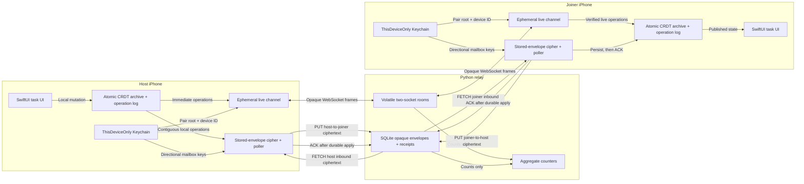
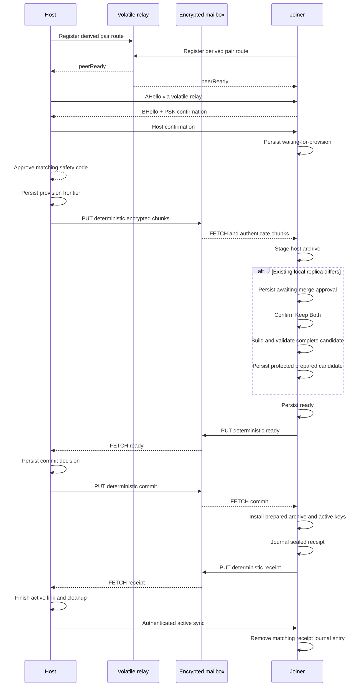
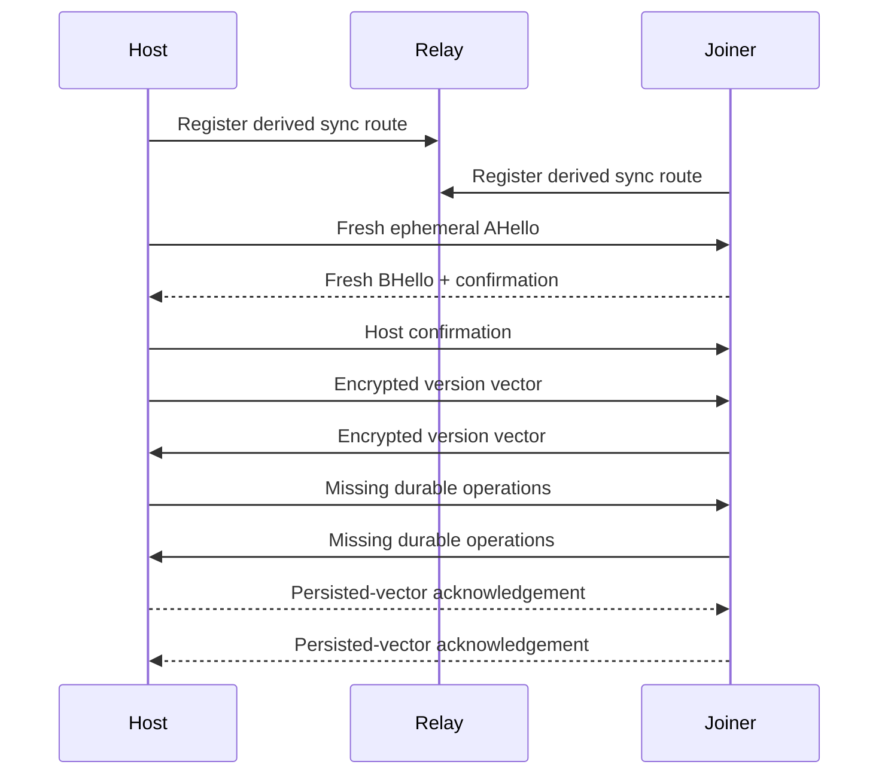
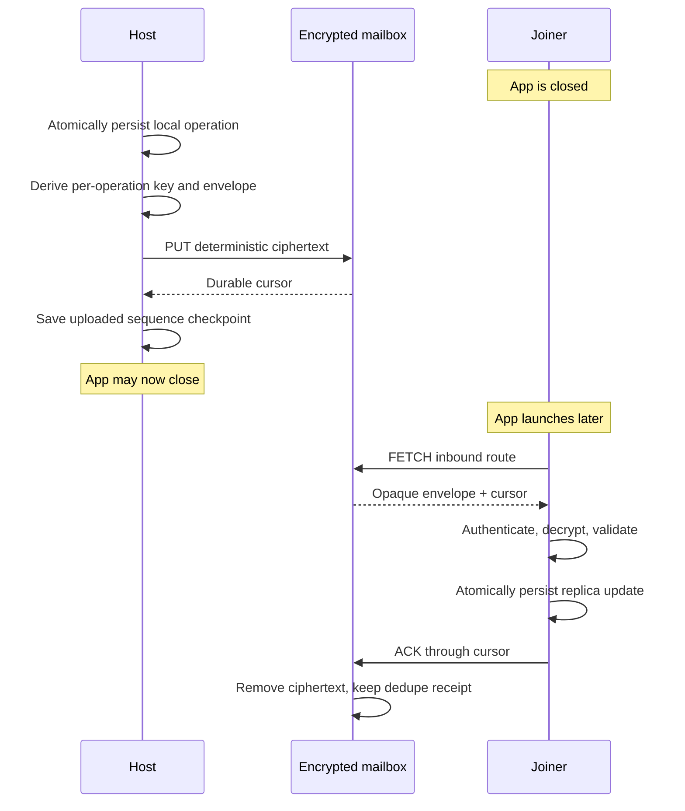
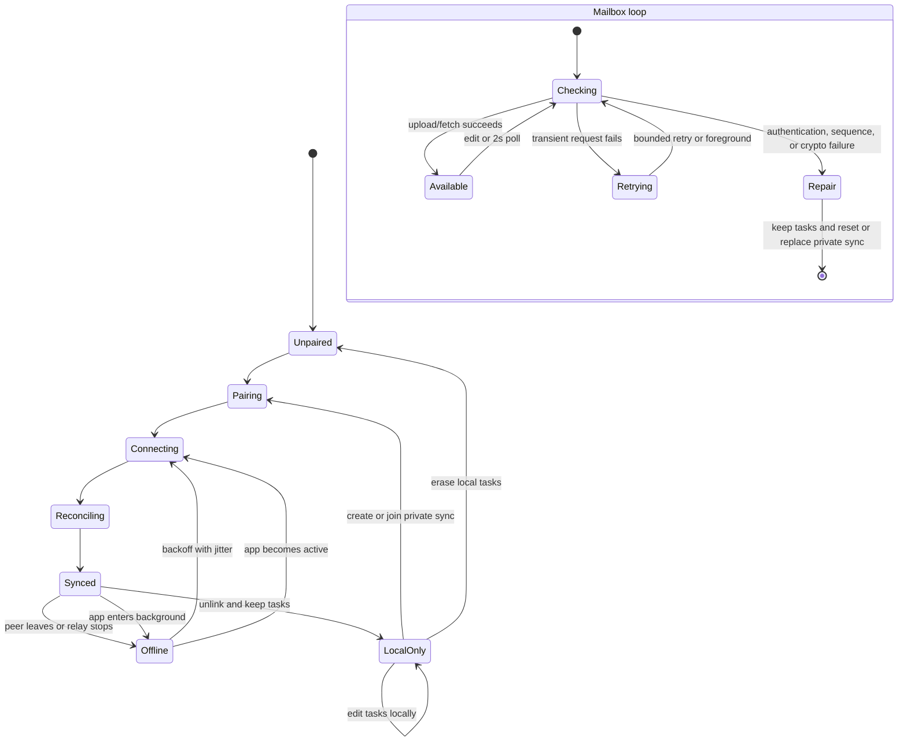

# Architecture and flows

## Runtime boundary

The WebSocket route remains the lowest-latency path and never persists frames.
The mailbox is a separate directional store-and-forward path. It has no task
API and never receives decryption keys or plaintext. SQLite retains opaque
envelopes until the receiving replica durably applies and acknowledges them,
an authorized unlink/erase/cleanup forgets the route, or retention expires.

| Device-only | Relay-visible |
| --- | --- |
| Task titles and completion state | Source IP and connection timing |
| Device IDs and pair ID | Stable pseudonymous sync route |
| Pair root and traffic keys | Ciphertext byte counts |
| Operation contents and version vectors | Which two live sockets share a route |
| Mailbox encryption roots and message-ID keys | Directional routes and global cursors |
| Mailbox plaintext and AEAD keys | Request authorization (not persisted), upload, fetch, ACK, size, and expiry timing |

## Pairing

The QR and 17-word phrase encode the same random 128-bit invitation. They never
contain the long-term pair root. Pairing uses PSK-authenticated ephemeral X25519
and explicit HMAC confirmation before the host can approve provisioning.
Provisioning rejects an archive larger than 280 KiB.

Pairing completion version 2 is bound into the authenticated handshake, so an
older live-only completion peer fails before either side persists pairing
state. Provision, ready, commit, receipt, and precommit abort each use distinct
directional pairing-control keys. Every local state is persisted before the
corresponding PUT may have succeeded, and deterministic ciphertext makes an
ambiguous response safe to retry after a disconnect or restart.

A supported non-empty join or re-link enters
`provisionStagedAwaitingMergeApproval` before ready. On confirmation, the
joiner builds a detached complete candidate from the staged host frontier and
its untouched local replica. Tasks with the same stable ID, title, and
completion state are reused; local-only or conflicting visible tasks receive
deterministic IDs. The candidate must satisfy the complete task, operation, and
origin limits and is written to a protected prepared-merge file before ready
is persisted or sent. A failed preflight leaves the main replica unchanged and
pairing cancellable. This is a value-level Keep Both operation, not a merge of
two unrelated CRDT histories.

Both roles can cancel while still precommit: the joiner while waiting for
provision or merge approval, and the host while publishing provision. The
sealed abort is journaled before pending state is removed. The host checks a
joiner abort before accepting ready and again before commit publication; the
joiner checks a host abort before accepting commit. An observed precommit abort
therefore takes precedence. Cancellation is locked once the commit decision can
have been published.

Abort and receipt terminal actions live in a separate device-only Keychain
journal bounded to 32 entries and keyed by pair ID plus action kind. An entry
contains only the already sealed envelope and the minimum route, authorization,
pair/device, and message metadata required to resend it; it does not retain the
pair root. The app republishes entries immediately on launch or foreground,
uses bounded backoff after failure, and re-attempts successfully stored entries
hourly so an expired or purged relay copy is recreated on a later attempt. The
relay's authenticated PUT response distinguishes a live payload from an
acknowledged receipt tombstone. Either terminal action is retired after that
peer-ACK proof, followed by best-effort route deletion. A matching receipt can
also retire after the joiner establishes a normal authenticated active-sync
session with the expected credentials.

A damaged terminal journal is never silently discarded. When active joiner
credentials contain the pairing archive hash, the app reconstructs the
deterministic sealed receipt, quarantines the damaged bytes, and atomically
restores a usable journal. Otherwise it keeps the valid replica and credentials
but surfaces repair and refuses a new pairing until the user explicitly resets
Private Sync while keeping tasks, or performs full erase.

On upgrade, a legacy pending record beside active credentials is treated as an
ambiguous one-sided link. Current pair credentials and the pending record are
cleared, tasks and install identity remain intact, and the UI requires a fresh
link. Staging, prepared-merge, and backup files without a live pending record
are nonessential orphans: their cleanup is best effort and cannot invalidate an
otherwise healthy active pair or disable local editing. Current attempts use
pair-ID-scoped artifact filenames, so an undeletable legacy or prior-attempt
file cannot become the next attempt's staging input. Full erase enumerates
every exact legacy name and canonical pair-ID-suffixed artifact before it
reports completion.

Abort consumption also has a durable receiver state. The recipient saves the
abort cursor and sender identity before ACK, can reconstruct the exact sealed
abort after restart, and clears pending state only after a PUT proves the relay
holds its acknowledged tombstone.

## Reconnect and reconciliation

No wall clock decides a merge. Each origin has a contiguous sequence, each
field uses a Lamport/device-ID last-writer-wins register, and deletion is a
permanent tombstone. Live edits are applied locally first and sent immediately
after the reconciliation barrier through one connection-scoped ordered drain.
A stale drain can close only the socket generation it captured. Catch-up uses
byte-aware batches bounded by both 256 operations and 256 KiB of canonical
operation data. A remote field
update that arrives before its task's create is retained as a hidden partial
record; it becomes visible only after a create is retained and both fields
exist.

## Offline store-and-forward

The sender does not equate a successful upload with peer delivery. Its
checkpoint means only that the relay durably accepted the ciphertext. The
receiver's replica persistence happens before ACK. If either HTTP response is
lost, deterministic envelopes and idempotent replica operations make retry
safe. Host-to-joiner and joiner-to-host use separate routes so a normal client
cannot consume its own outbound queue.

The active app polls every two seconds and also starts a cycle immediately on
launch, foregrounding, and local edit. Failure uses bounded backoff. Background
entry asks iOS for enough time to finish one best-effort cycle; no background
wake or force-quit guarantee is claimed.

## Connection and mailbox state

