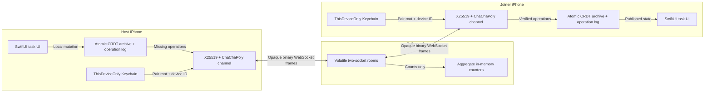
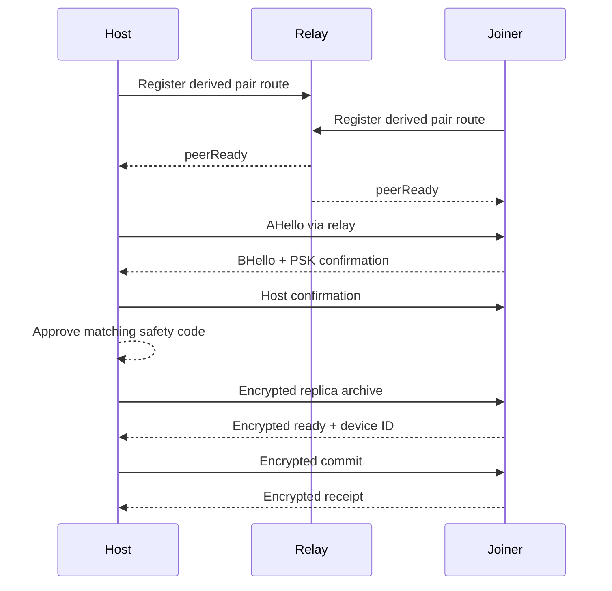
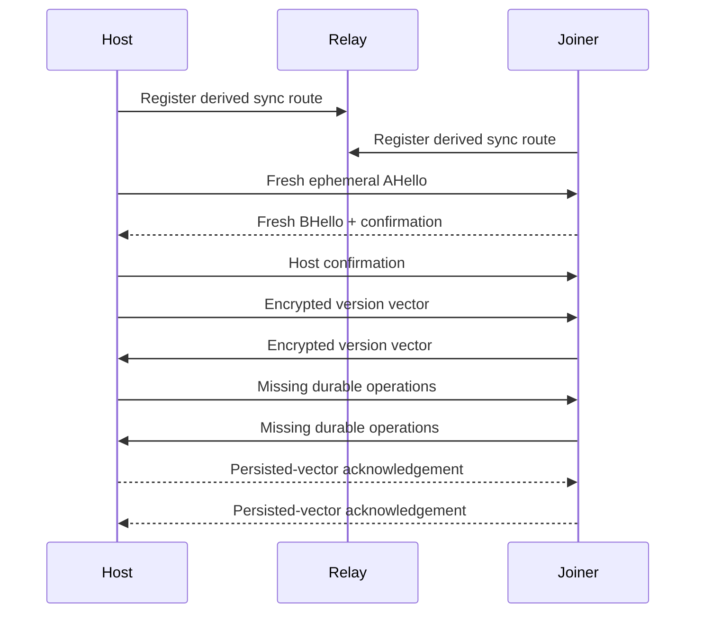
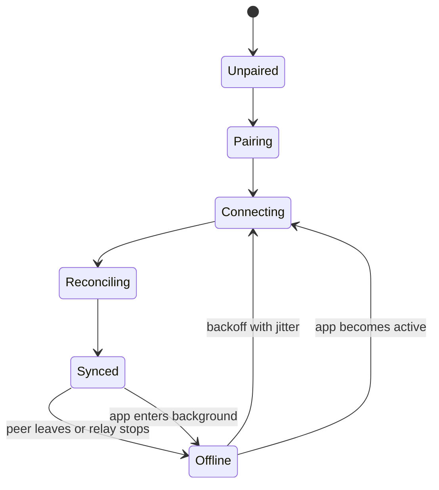

# Architecture and flows

## Runtime boundary

The relay has no datastore, mailbox, device registry, or task API. Each device
is its own durable mailbox. If both replicas are offline, no delivery is
possible. The POC relay bounds process state to 256 live sockets and 128 rooms
by default, and expires a route with one waiting peer after two minutes.

| Device-only | Relay-visible |
| --- | --- |
| Task titles and completion state | Source IP and connection timing |
| Device IDs and pair ID | Stable pseudonymous sync route |
| Pair root and traffic keys | Ciphertext byte counts |
| Operation contents and version vectors | Which two live sockets share a route |

## Pairing

The QR and 17-word phrase encode the same random 128-bit invitation. They never
contain the long-term pair root. Pairing uses PSK-authenticated ephemeral X25519
and explicit HMAC confirmation before the host can approve provisioning.
Provisioning rejects an archive larger than 280 KiB.

The pending record and staged joiner archive are rolled back on cancellation,
terminal pre-commit failure, or a later launch without active credentials.
This avoids silently activating an incomplete join, but it does not solve the
two-generals commit boundary: interruption after the host saves active
credentials and before the joiner does can require resetting and pairing both
devices again.

## Reconnect and reconciliation

No wall clock decides a merge. Each origin has a contiguous sequence, each
field uses a Lamport/device-ID last-writer-wins register, and deletion is a
permanent tombstone. Live edits are applied locally first and sent immediately
after the reconciliation barrier through one connection-scoped ordered drain.
A stale drain can close only the socket generation it captured. Catch-up uses
byte-aware batches bounded by both 256 operations and 256 KiB of canonical
operation data. A remote field
update that arrives before its task's create is retained as a hidden partial
record; it becomes visible only after a create is retained and both fields
exist.

## Foreground state

