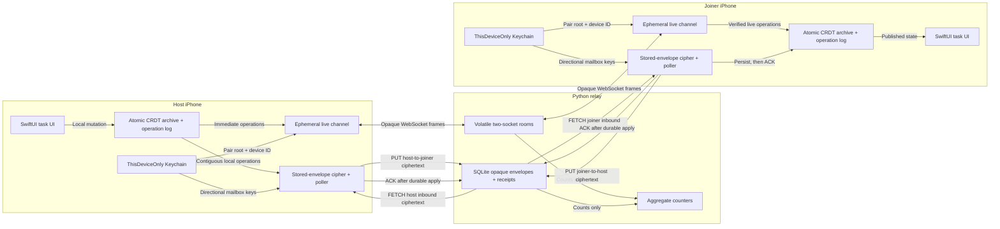
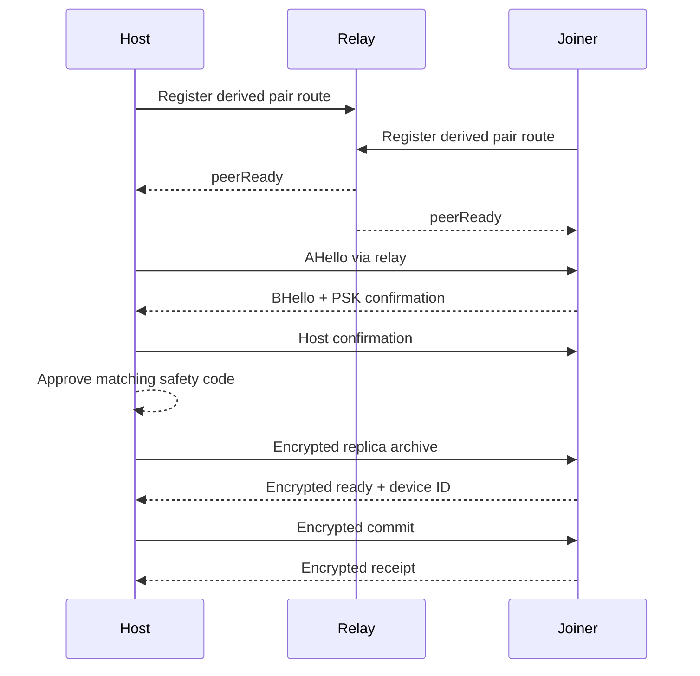
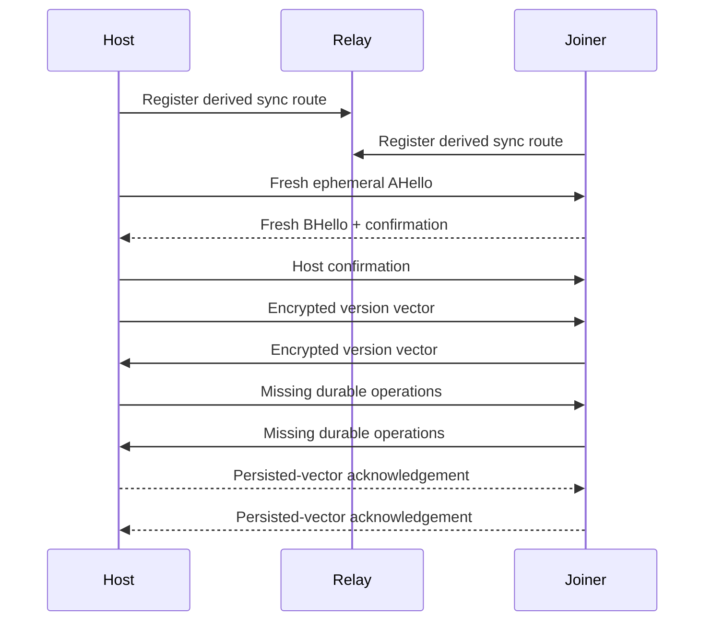
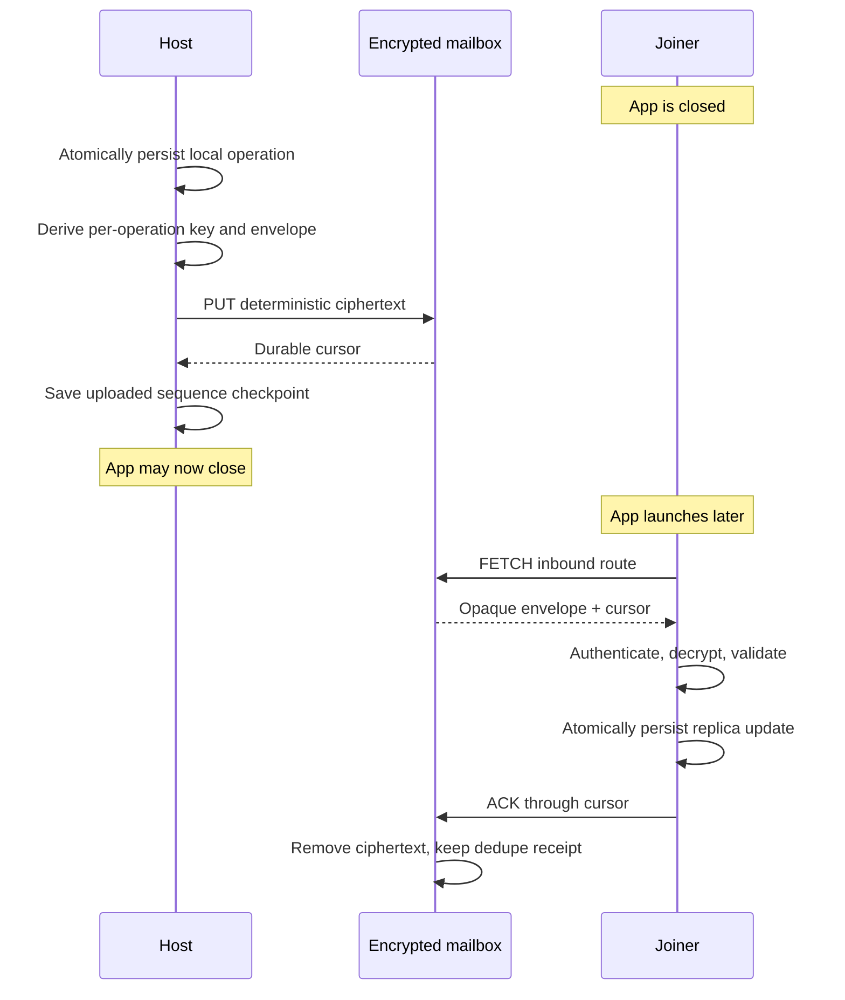
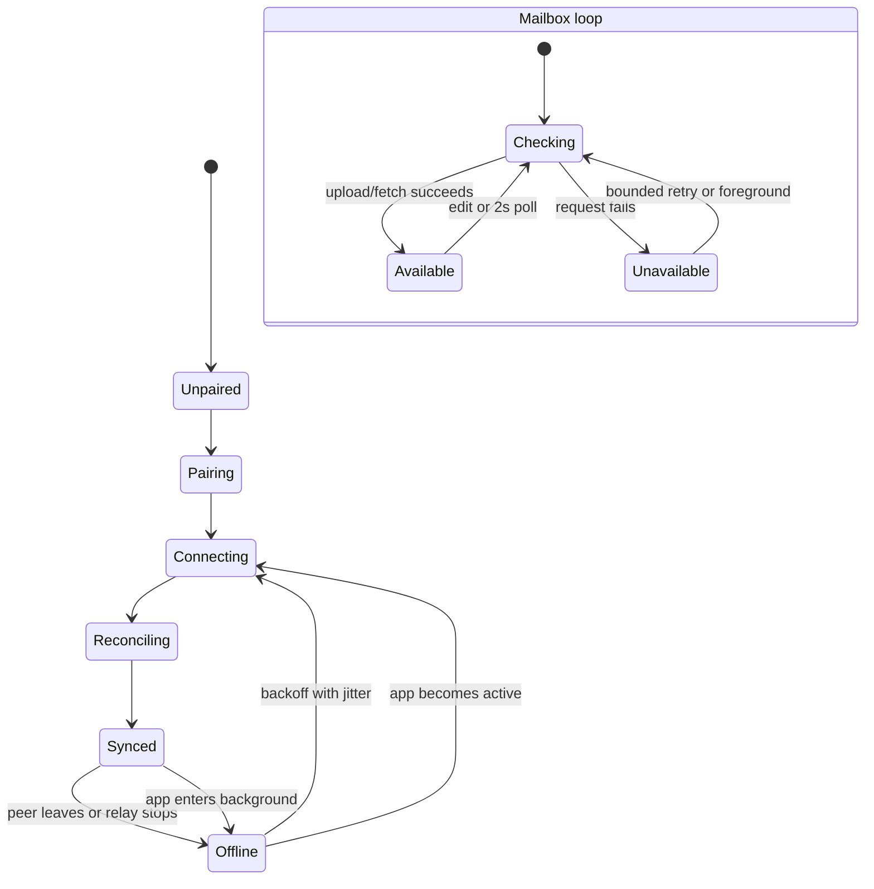

# Architecture and flows

## Runtime boundary

The WebSocket route remains the lowest-latency path and never persists frames.
The mailbox is a separate directional store-and-forward path. It has no task
API and never receives decryption keys or plaintext. SQLite retains opaque
envelopes until the receiving replica durably applies and acknowledges them, or
until retention expires.

| Device-only | Relay-visible |
| --- | --- |
| Task titles and completion state | Source IP and connection timing |
| Device IDs and pair ID | Stable pseudonymous sync route |
| Pair root and traffic keys | Ciphertext byte counts |
| Operation contents and version vectors | Which two live sockets share a route |
| Mailbox encryption roots and message-ID keys | Directional routes and global cursors |
| Mailbox plaintext and AEAD keys | Request authorization (not persisted), upload, fetch, ACK, size, and expiry timing |

## Pairing

The QR and 17-word phrase encode the same random 128-bit invitation. They never
contain the long-term pair root. Pairing uses PSK-authenticated ephemeral X25519
and explicit HMAC confirmation before the host can approve provisioning.
Provisioning rejects an archive larger than 280 KiB.

The pending record and staged joiner archive are rolled back on cancellation,
terminal pre-commit failure, or a later launch without active credentials.
This avoids silently activating an incomplete join, but it does not solve the
two-generals commit boundary: interruption after the host saves active
credentials and before the joiner does can require resetting and pairing both
devices again.

## Reconnect and reconciliation

No wall clock decides a merge. Each origin has a contiguous sequence, each
field uses a Lamport/device-ID last-writer-wins register, and deletion is a
permanent tombstone. Live edits are applied locally first and sent immediately
after the reconciliation barrier through one connection-scoped ordered drain.
A stale drain can close only the socket generation it captured. Catch-up uses
byte-aware batches bounded by both 256 operations and 256 KiB of canonical
operation data. A remote field
update that arrives before its task's create is retained as a hidden partial
record; it becomes visible only after a create is retained and both fields
exist.

## Offline store-and-forward

The sender does not equate a successful upload with peer delivery. Its
checkpoint means only that the relay durably accepted the ciphertext. The
receiver's replica persistence happens before ACK. If either HTTP response is
lost, deterministic envelopes and idempotent replica operations make retry
safe. Host-to-joiner and joiner-to-host use separate routes so a normal client
cannot consume its own outbound queue.

The active app polls every two seconds and also starts a cycle immediately on
launch, foregrounding, and local edit. Failure uses bounded backoff. Background
entry asks iOS for enough time to finish one best-effort cycle; no background
wake or force-quit guarantee is claimed.

## Connection and mailbox state

