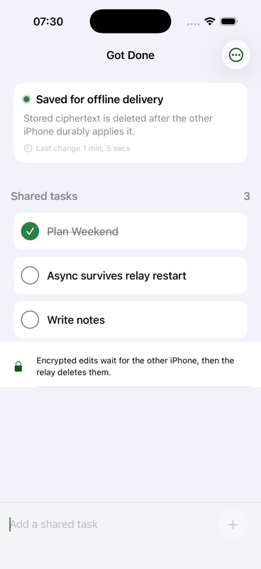
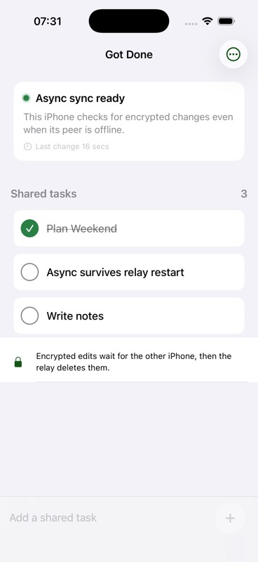

# Verification results

Verified on 2026-07-28 with iPhone 17 Pro and iPhone 17 simulators on the
local machine.

## Automated checks

- XcodeBuildMCP simulator suite: 38 passed, 0 failed, 0 build warnings.
- XcodeBuildMCP Release simulator build: succeeded with 0 warnings.
- Python relay suite: 37 tests and 12 subtests passed.
- Python bytecode compilation and dependency compatibility checks passed.
- Existing replication coverage includes duplicate delivery, Lamport
  tie-breaking, independent fields, gaps, forks, persistence, provisioning,
  bounds, and remove-wins delivery permutations.
- Mailbox crypto coverage includes an independently generated fixed vector,
  direction separation, deterministic retry bytes, tampering, wrong-pair
  rejection, and envelope bounds.
- Store-and-forward coverage includes offline delivery, streamed response
  limits, retry after a committed PUT loses its response, restart from a
  Keychain checkpoint, redelivery after an ACK failure, exactly-once replica
  application, erase-versus-request races, authorization, quotas, expiry,
  receipt tombstones, and SQLite restart recovery.

## Two-simulator async proof

The final proof used the real iOS clients and the persistent Python relay, not
an in-process transport substitute:

1. The already paired host and joiner reached live sync.
2. The joiner app was stopped, leaving only the host online.
3. The host created `Async survives relay restart`.
4. The host displayed `Saved for offline delivery` after the relay durably
   accepted the encrypted envelope.
5. The mailbox database contained one live 226-byte ciphertext. The host app
   was then stopped too.
6. The relay process was stopped. SQLite reported `ok` from
   `PRAGMA integrity_check`, with the same ciphertext still present.
7. The relay restarted against the same database.
8. Only the joiner app was launched. The task appeared within about four
   seconds while the host remained stopped.
9. After the joiner durably applied and acknowledged the operation, the relay
   retained zero live payload bytes. It kept the non-payload receipt needed to
   prevent a retry from resurrecting the acknowledged message.

The database transition was:

| Checkpoint | Receipts | Live payloads | Live payload bytes |
| --- | ---: | ---: | ---: |
| Sender stopped, before relay restart | 28 | 1 | 226 |
| Receiver applied and acknowledged | 28 | 0 | 0 |

After restart, relay metrics recorded one fetched and one acknowledged mailbox
message with no authentication, protocol, capacity, or internal errors.

This exercises the requested boundary: the sending iPhone, receiving iPhone,
and relay were never required to be online simultaneously for delivery.

## Live-path latency

The final regression run sent 1,000 sequential 256-byte binary round trips
through two local WebSocket clients:

| Metric | Observed |
| --- | ---: |
| p50 | 0.350 ms |
| p95 | 0.488 ms |
| worst single sample | 0.911 ms |

These are local relay timings, not internet, end-to-end UI, or device-energy
claims. Foreground mailbox polling currently targets roughly two seconds and
uses bounded jittered backoff after failure. In the simulator restart proof,
launch-to-visible delivery was within about four seconds.

The live path still sends an encrypted operation immediately. The mailbox path
first commits the same logical operation locally, uploads a deterministic
encrypted envelope, and advances its local checkpoint only after the relay
transaction succeeds.

Run the live relay benchmark with:

```sh
cd relay
.venv/bin/python benchmark.py --iterations 1000 --payload-bytes 256
```

## Visual comparison

| Before: live-only wording | Sender: peer offline | Receiver: after relay restart |
| --- | --- | --- |
|  |  |  |

The full live and durable paths are diagrammed in
[ARCHITECTURE.md](ARCHITECTURE.md).

## Scope of the evidence

This proves foreground two-device behavior against a local persistent relay,
including delivery after both clients and the relay have stopped. The relay
stores ciphertext, routing tokens, expiry information, and aggregate metrics;
it does not receive the content key or plaintext.

It does not establish a production cryptographic audit, internet behavior,
multi-device membership, revocation, long-term load behavior, push
notifications, or compatibility with the production Got Done data model. iOS
background execution is best effort: an edit already accepted by the relay is
safe, but an edit made without connectivity cannot reach the other phone until
that source app gets another execution opportunity and reconnects. Force-quit
cannot be treated as a guaranteed final network flush.

Acknowledged ciphertext is removed immediately at the logical database level.
Idempotency receipts expire under the configured retention cap, which defaults
to 365 days for this POC. SQLite pages, WAL files, backups, TLS termination,
abuse controls, and operational deletion policies need production hardening
before claiming forensic erasure.
