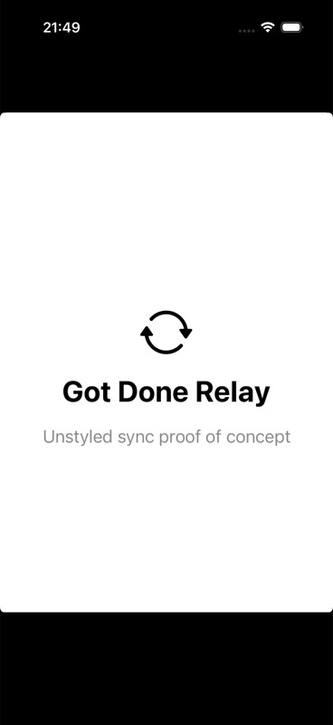
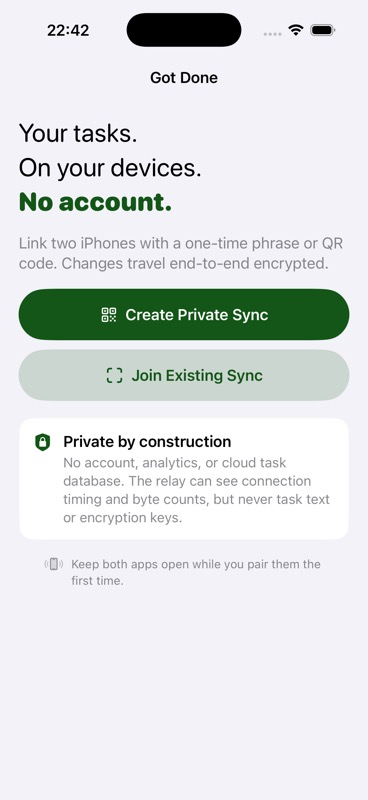
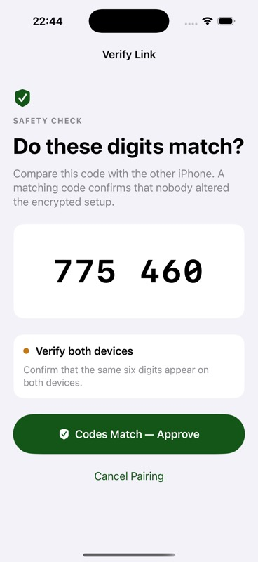
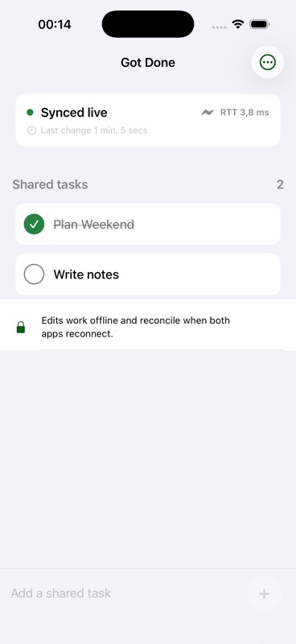

# Verification results

Verified on 2026-07-27 with iPhone 17 Pro and iPhone 17 simulators on the
local machine.

## Automated checks

- XcodeBuildMCP simulator suite: 30 passed, 0 failed, 0 build warnings.
- Python relay suite: 18 tests and 9 subtests passed.
- Python dependency check: compatible pinned environment.
- Replication permutations cover duplicate delivery, Lamport tie-breaking,
  field independence, cross-origin updates arriving before create, gaps, forks,
  persistence, provisioning, bounds, and six valid delivery orders around a
  remove-wins tombstone.
- Security tests cover deterministic cross-role key agreement, explicit
  confirmation, a fixed encrypted-frame vector, checksum validation, duplicate
  QR fields, AEAD tampering, strict frame sequence replay rejection, and
  ThisDeviceOnly Keychain round-trips. Erase recovery is exercised at every
  boundary between the two Keychain deletions, replica deletion/recreation, and
  final recovery-marker removal. Rejected edits keep their recoverable error
  state until the user changes or successfully resubmits the draft. A
  fault-injected runtime persistence failure remains fatal across app lifecycle
  callbacks instead of reconnecting an unsafe replica.

## Two-simulator proof

1. The host generated a QR and a random 17-word invitation.
2. The joiner entered the phrase manually.
3. Both simulators independently displayed safety code `775 460`.
4. Host approval provisioned the encrypted archive and both devices reached
   `Synced live`.
5. A task created on the joiner appeared on the host.
6. Completing it on the host appeared on the joiner.
7. The relay was stopped and `Write notes` was created locally on the joiner.
   It remained absent from the host while the relay was unavailable.
8. Restarting the relay caused both apps to perform a fresh authenticated
   handshake and the missing operation reconciled.
9. The first outage run exposed an indefinite `waitsForConnectivity` stall.
   The transport was changed to fail WebSocket opening after five seconds and
   enter bounded exponential backoff. A second stop/restart then reconnected
   automatically without relaunching either app.
10. After relay hardening and the final rebuild, a completion changed on the
    joiner appeared on the host, and the host's reversal appeared on the
    joiner.
11. A final sequential-toggle stress pass spanned a forced relay shutdown.
    Both apps reconnected without relaunching, converged to the same task
    registers, and stayed on the recovered connection.

After the final stress reconnect, relay counters reported no protocol errors,
queue overflows, rejected registrations, internal errors, or dropped pre-peer
frames. Only the two app sockets and one sync room remained live. The final
two-minute waiting bound matches the invitation deadline; the short-duration
integration tests exercise expiry and capacity recovery.

## Loopback latency

The final hardened relay was measured in four consecutive runs of 1,000
sequential 256-byte binary round trips through two WebSocket clients:

| Metric | Observed range |
| --- | ---: |
| p50 | 0.375–0.450 ms |
| p95 | 0.537–0.865 ms |
| worst single sample | 23.325 ms |

The encrypted in-app ping path displayed roughly 2–17 ms during simulator
interaction, 3.9–8.3 ms during the final bidirectional smoke test, and
3.8/2.4 ms in the final joiner/host screenshots. The 23.325 ms relay sample was
a single local scheduling outlier. These are loopback development
measurements, not internet or device-energy claims.

The measurements cover the live transport and small demo replica. They do not
measure local commit or durable peer acknowledgement near the 10,000-operation
limit. The POC currently rewrites its complete canonical JSON archive on every
mutation; replacing that with indexed SQLite/WAL storage is a production
scaling requirement, not a result established here.

The live path has no polling. Interactive operations are locally committed and
sent as a single encrypted frame immediately. Reconnect uses version vectors
instead of replaying the full archive.

Run the relay-only benchmark with:

```sh
cd relay
.venv/bin/python benchmark.py --iterations 1000 --payload-bytes 256
```

## Visual comparison

| Before | After |
| --- | --- |
|  |  |

| Pair approval | Host synced | Joiner synced |
| --- | --- | --- |
|  |  |  |

## Scope of the evidence

This proves foreground two-device behavior against a local stateless relay. It
does not establish production cryptographic assurance, internet behavior,
background delivery, multi-device membership, revocation, long-term load
characteristics, or compatibility with the production Got Done data model.
In particular, the staged pairing commit is not crash-atomic: interruption
after the host becomes active but before the joiner does can require a local
reset and a new pairing on both devices.
