# Verification results

Verified on 2026-07-28 with iPhone 17 Pro and iPhone 17 simulators on the
local machine.

## Automated checks

- XcodeBuildMCP simulator suite: 98 passed, 0 failed, 0 skipped, 0 build
  warnings or errors.
- Focused Keep Both candidate suite: 4 passed, covering deterministic exact
  reuse and failure-atomic task, operation, and origin capacity boundaries.
- Focused terminal pairing journal suite: 9 passed, covering sealed-record
  validation, bounded multi-pair storage, duplicate/conflict rejection,
  pending-to-journal ordering, legacy decode compatibility, and strict
  foreign-action rejection.
- Focused pairing recovery suite: 20 passed, covering restart frontiers,
  precommit cancellation, prepared merges, terminal receipt recovery, legacy
  forced re-link, and nonfatal orphan cleanup.
- Focused mailbox-capacity UX test: passed, verifying that relay capacity
  rejection preserves the pending edit and produces actionable recovery copy.
- XcodeBuildMCP Release simulator builds: fail-closed and production-style
  WSS/HTTPS-injected configurations both succeeded with 0 warnings.
- Python relay suite: 48 tests and 22 subtests passed in the unrestricted
  loopback run. The final restricted rerun passed all 22 non-network tests; 26
  integration cases were denied permission to bind a loopback port before
  their assertions ran.
- Python bytecode compilation and dependency compatibility checks passed.
- Existing replication coverage includes duplicate delivery, Lamport
  tie-breaking, independent fields, gaps, forks, persistence, provisioning,
  bounds, and remove-wins delivery permutations.
- Mailbox crypto coverage includes an independently generated fixed vector,
  direction separation, deterministic retry bytes, tampering, wrong-pair
  rejection, and envelope bounds.
- Store-and-forward coverage includes offline delivery, streamed response
  limits, retry after a committed PUT loses its response, restart from a
  Keychain checkpoint, redelivery after an ACK failure, exactly-once replica
  application, erase-versus-request races, authorization, quotas, expiry,
  receipt tombstones, and SQLite restart recovery.
- Durable pairing coverage includes provision chunking, authenticated ready,
  commit, receipt, and abort records, ambiguous response retries, restart at
  each stored state, tamper rejection without state mutation, complete
  pre-ready Keep Both validation, server-acknowledged terminal-action
  retirement, crash-durable abort acknowledgement, damaged-journal
  reconstruction or task-preserving recovery reset, pair-attempt-scoped
  artifacts with complete erase discovery, legacy ambiguous-link recovery,
  nonfatal orphan cleanup, and re-linking a previously known device without
  origin-sequence forks.

## Two-simulator pairing and convergence proof

The final pairing run used two simulators that had previously shared 18 tasks,
then unlinked while keeping their local replicas:

1. Both unlinked phones still displayed and could edit the same 18 tasks.
2. The joiner created one additional local-only task, bringing only that phone
   to 19.
3. The host created a new one-time invitation and both phones displayed safety
   code `272929`; only the host could approve.
4. The host published its 18-task encrypted frontier through pairing-control
   v2. The joiner recognized its earlier device history and resumed after the
   imported sequence frontier without a fork.
5. The joiner paused before ready and required an explicit
   **Keep Both Task Lists and Finish** confirmation. The complete candidate
   reused all 18 unchanged tasks and added only the one local-only task.
6. Both phones activated only after commit and receipt completed, then
   converged to exactly 19 visible tasks rather than duplicating the shared
   archive.

The runtime exercise first exposed two issues—no join action from the local-only
dashboard and a safe re-link being rejected as a device collision. Both were
fixed and covered by the automated suites.

## Two-simulator concurrent edit proof

Immediately before the final re-pairing proof above, both simulators were at
the same 16-task frontier. The joiner created
`Keiner concurrent final` and the host observed task 17. The host then created
`Host concurrent final`; both phones converged to the same 18-task replica with
both independently authored tasks visible at the top.

| Host after both edits | Joiner after both edits |
| --- | --- |
| 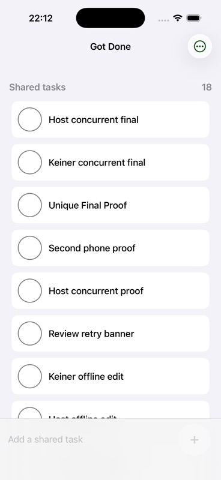 | 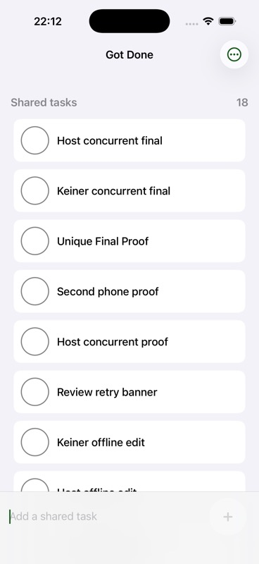 |

## Two-simulator async proof

The final proof used the real iOS clients and the persistent Python relay, not
an in-process transport substitute:

1. The already paired host and joiner reached live sync.
2. The joiner app was stopped, leaving only the host online.
3. The host created `Async survives relay restart`.
4. The relay durably accepted the encrypted envelope and the host advanced its
   upload checkpoint. In the reviewed UI, the transient saving state then
   returns to a quiet healthy dashboard.
5. The mailbox database contained one live 226-byte ciphertext. The host app
   was then stopped too.
6. The relay process was stopped. SQLite reported `ok` from
   `PRAGMA integrity_check`, with the same ciphertext still present.
7. The relay restarted against the same database.
8. Only the joiner app was launched. The task appeared within about four
   seconds while the host remained stopped.
9. After the joiner durably applied and acknowledged the operation, the relay
   retained zero live payload bytes. It kept the non-payload receipt needed to
   prevent a retry from resurrecting the acknowledged message.

The database transition was:

| Checkpoint | Receipts | Live payloads | Live payload bytes |
| --- | ---: | ---: | ---: |
| Sender stopped, before relay restart | 28 | 1 | 226 |
| Receiver applied and acknowledged | 28 | 0 | 0 |

After restart, relay metrics recorded one fetched and one acknowledged mailbox
message with no authentication, protocol, capacity, or internal errors.

This exercises the requested boundary: the sending iPhone, receiving iPhone,
and relay were never required to be online simultaneously for delivery.

## Live-path latency

The final regression run sent 1,000 sequential 256-byte binary round trips
through two local WebSocket clients:

| Metric | Observed |
| --- | ---: |
| p50 | 0.350 ms |
| p95 | 0.488 ms |
| worst single sample | 0.911 ms |

These are local relay timings, not internet, end-to-end UI, or device-energy
claims. Foreground mailbox polling currently targets roughly two seconds and
uses bounded jittered backoff after failure. In the simulator restart proof,
launch-to-visible delivery was within about four seconds.

The live path still sends an encrypted operation immediately. The mailbox path
first commits the same logical operation locally, uploads a deterministic
encrypted envelope, and advances its local checkpoint only after the relay
transaction succeeds.

Run the live relay benchmark with:

```sh
cd relay
.venv/bin/python benchmark.py --iterations 1000 --payload-bytes 256
```

## Earlier async transport instrumentation

These screenshots were captured during the store-and-forward instrumentation
run. The later UX pass removed the sender's persistent “stored” status once no
action is required.

| Before: live-only wording | Earlier sender instrumentation | Receiver: after relay restart |
| --- | --- | --- |
|  |  |  |

The full live and durable paths are diagrammed in
[ARCHITECTURE.md](ARCHITECTURE.md).

## UX review verification

The reviewed build keeps healthy sync quiet, surfaces only actionable saving,
retry, or repair states, and no longer labels every relay failure as internet
loss. Invitation expiry is visible and available to VoiceOver, phrase errors
are validated before pairing state changes, deletion has a five-second
pre-commit Undo, and unlinking leaves tasks visible and editable on the local
iPhone.

| Before onboarding | Reviewed onboarding |
| --- | --- |
| 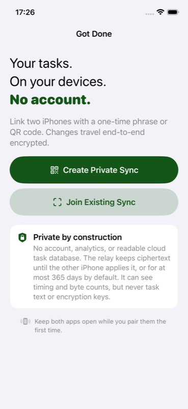 | 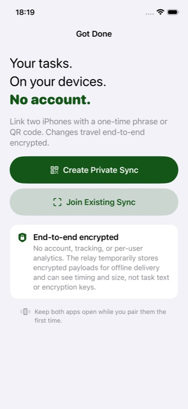 |

| Before dashboard | Quiet healthy dashboard |
| --- | --- |
| 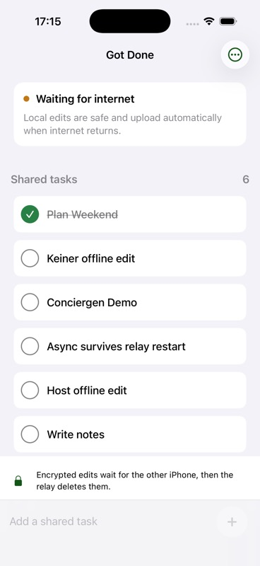 | 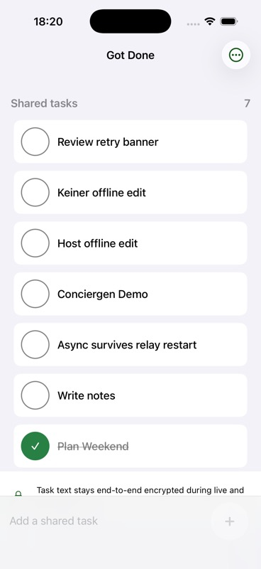 |

| Truthful retry state | Tasks after unlink |
| --- | --- |
| 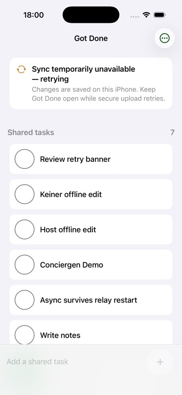 | 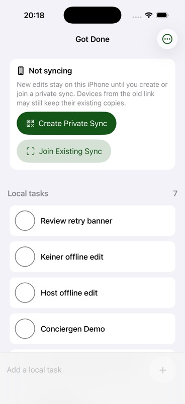 |

| Pairing expiry | Simulator phrase entry |
| --- | --- |
| 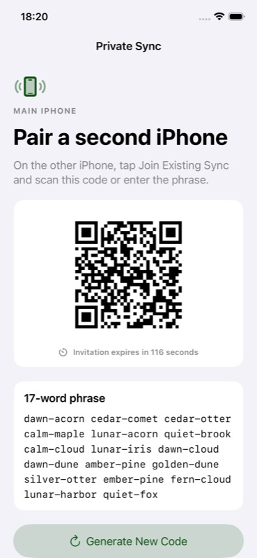 | 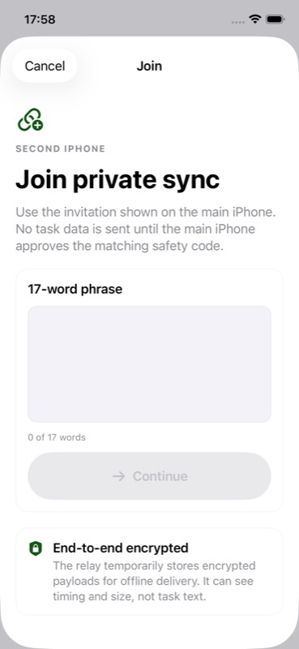 |

| Before merge layout polish | Reviewed pre-ready merge |
| --- | --- |
| 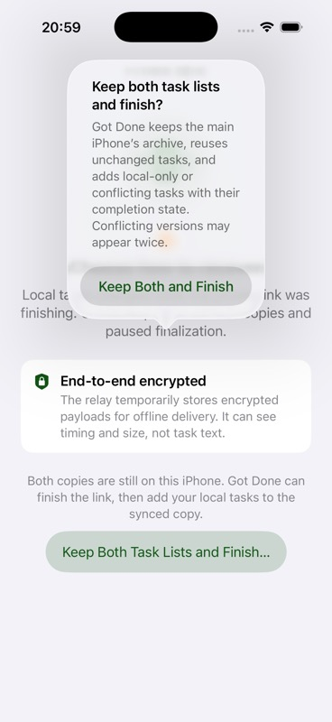 | 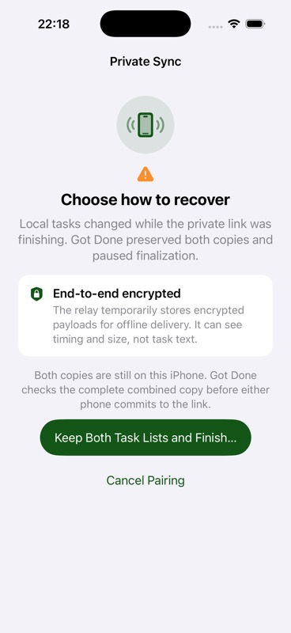 |

| Explicit non-empty merge recovery | Release build without endpoints |
| --- | --- |
|  | 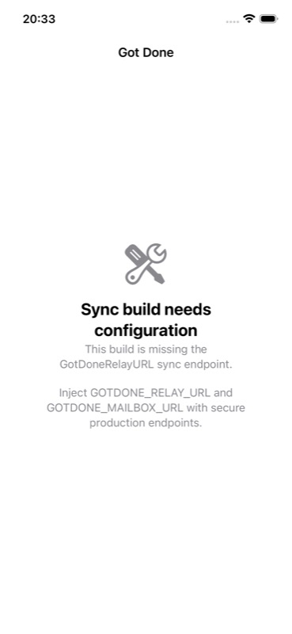 |

| Host after two-device convergence | Joiner after two-device convergence |
| --- | --- |
| 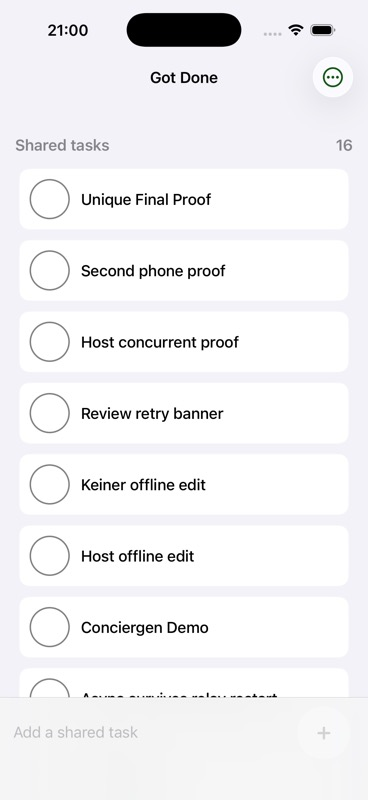 |  |

## Scope of the evidence

This proves foreground two-device behavior against a local persistent relay,
including delivery after both clients and the relay have stopped. The relay
stores ciphertext, routing tokens, global cursors, keyed message IDs and
hashes, deduplication receipts, expiry information, and aggregate metrics. It
does not receive the content key or plaintext.

It does not establish a production cryptographic audit, internet behavior,
multi-device membership, revocation, long-term load behavior, push
notifications, or compatibility with the production Got Done data model. iOS
background execution is best effort: an edit already accepted by the relay is
safe, but an edit made without connectivity cannot reach the other phone until
that source app gets another execution opportunity and reconnects. Force-quit
cannot be treated as a guaranteed final network flush.

Acknowledged ciphertext is removed immediately at the logical database level,
and the active SQLite connection enables `secure_delete`.
Idempotency receipts expire under the configured retention cap, which defaults
to 365 days for this POC. SQLite pages, WAL files, backups, TLS termination,
abuse controls, and operational deletion policies need production hardening
before claiming forensic erasure.
